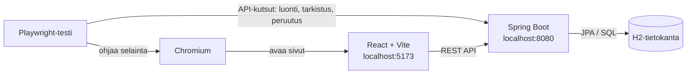
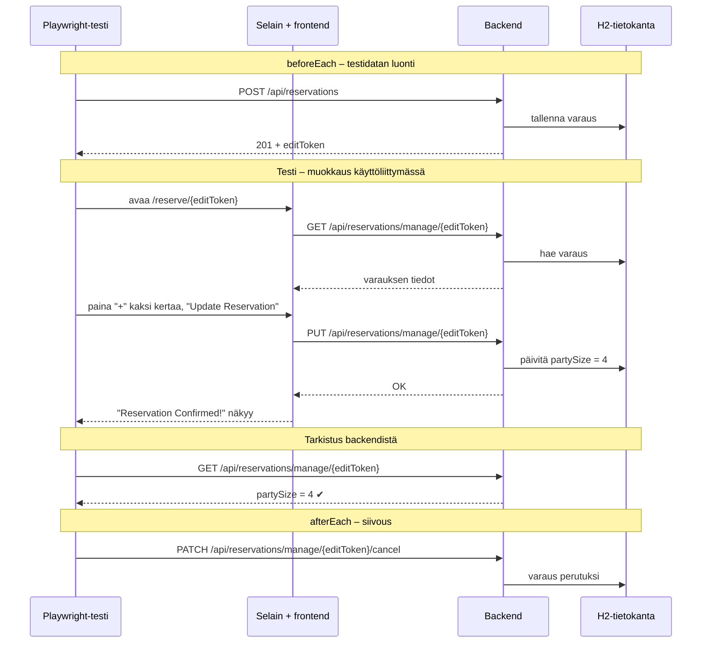

# Järjestelmätestaus Playwrightilla – varauksen muokkaus

## Tavoite

Pants on ravintolan pöytävarausjärjestelmä (React-frontend, Spring Boot -backend).
Projektin aiemmat Playwright-testit korvasivat backendin vastaukset mockeilla
(`page.route`), joten ne testasivat vain käyttöliittymää.

Harjoitustyön tavoitteena oli tehdä järjestelmätesti (E2E), joka testaa varauksen
muokkaamisen koko järjestelmän läpi: oikea selain, frontend, backend ja tietokanta.

## Teknologiat

- **Playwright (TypeScript):** selaimen ohjaus ja API-kutsut testissä
- **React + Vite:** frontend
- **Spring Boot:** backend ja REST-rajapinta
- **H2-tietokanta:** muistitietokanta, joka nollautuu joka käynnistyksellä

## Toteutus

Testit ovat tiedostossa
[`frontend/tests/reservation-modify-e2e.spec.ts`](https://github.com/TiimiPANTS/pants/blob/dev/frontend/tests/reservation-modify-e2e.spec.ts).

### Testien valmistelu

- **Testit ajetaan peräkkäin** (`mode: 'serial'`), koska ne käyttävät samaa
  tietokantaa ja samoja varausaikoja.
- **Päivämäärä lasketaan aina tulevaisuuteen:** seuraavan kuun 10. päivä, tai 11.
  päivä, jos 10. päivä on sunnuntai, jolloin ravintola on kiinni. Kiinteä päivämäärä
  lakkaisi toimimasta, kun se menee ohi.
- **Ennen jokaista testiä** (`beforeEach`) luodaan uusi varaus suoraan backendin
  rajapinnan kautta (`POST /api/reservations`). Backend palauttaa `editToken`in,
  jolla varausta voi muokata. Varauksen luominen API:n kautta on nopeampaa kuin
  käyttöliittymän kautta, ja jokainen testi alkaa puhtaasta tilanteesta.
- **Jokaisen testin jälkeen** (`afterEach`) varaus perutaan, jotta testidataa ei
  jää tietokantaan varaamaan aikoja.

### Testit

| Testi | Mitä se tarkistaa |
|---|---|
| Varauksen luonti käyttöliittymässä | Asiakas valitsee päivän ja ajan, täyttää tiedot ja vahvistaa. Sen jälkeen hän pääsee muokkaussivulle, jossa hänen nimensä näkyy. |
| Muokkaussivu näyttää tiedot | Varauksen nimi, sähköposti ja henkilömäärä tulevat oikein backendistä. |
| Henkilömäärän muutos | Määrä muutetaan 2 → 4. |
| Ajan muutos | Aika muutetaan 12:00 → 14:00. |
| Nimen ja lisätietojen muutos | Etunimi ja lisätiedot ("Birthday dinner") tallentuvat. |
| Muutokset säilyvät | Kun muokkaussivu avataan uudelleen, muutettu nimi näkyy edelleen. |

### Tulos tarkistetaan tietokannasta, ei vain ruudulta

Muokkaustesteissä ei riitä, että ruudulle tulee "Reservation Confirmed!". Testi hakee
muutoksen jälkeen varauksen uudelleen backendistä
(`GET /api/reservations/manage/{editToken}`) ja tarkistaa, että muutos on oikeasti
tallentunut, esim. `partySize` on 4. Näin testi huomaa myös tilanteen, jossa
käyttöliittymä näyttää onnistumisen mutta tieto ei tallennu.

### Testien ajaminen 

    # terminaali 1
    cd backend
    $bytes = New-Object byte[] 32
    [Security.Cryptography.RandomNumberGenerator]::Create().GetBytes($bytes)
    $env:JWT_SECRET = [Convert]::ToBase64String($bytes)
    .\mvnw spring-boot:run

    # terminaali 2
    cd frontend
    npx playwright test tests/reservation-modify-e2e.spec.ts --project=chromium

## Mitä opin

✍️ Kirjoita omin sanoin, esimerkiksi:
- mock-testin ja järjestelmätestin ero: mitä kumpikin löytää ja mitä ei
- miksi testidata pitää luoda ja siivota jokaista testiä varten
- miksi tulos kannattaa tarkistaa backendistä eikä vain ruudulta

## Mitä tekisin toisin

- Paikallisesti backend pitää käynnistää käsin. Playwrightin `webServer`-asetuksen
  voisi laajentaa käynnistämään myös backendin.
- Paikallisesti testit ajetaan kolmella selaimella rinnakkain. `serial` koskee vain
  yhtä selainta kerrallaan, joten eri selainten testit voivat varata samoja aikoja
  yhtä aikaa. Siksi paikallisesti kannattaa käyttää `--project=chromium`.

## Jatkokehitysideat

- Testi sille, ettei varausta voi muuttaa täyteen aikaan
- Testi sille, ettei peruttua varausta voi enää muokata
- E2E-testi omistajan kirjautumiselle ja dashboardille

## Mermaid kaaviot

Kaavio näyttää, että testi käyttää järjestelmää kahta reittiä: selaimen kautta kuten käyttäjä ja suoraan API:n kautta testidatan luontiin ja tarkistukseen.

### Yhden testin kulku ("customer can change the party size")

Kaavio näyttää koko testin järjestyksessä: data luodaan, sitä muokataan käyttöliittymässä, tulos tarkistetaan backendistä ja lopuksi siivotaan.

