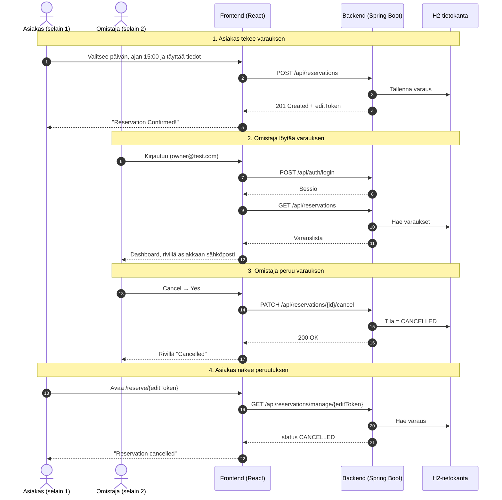

# Järjestelmätestaus Playwrightilla – varauksen elinkaari

## Tavoite

Pants on ravintolan pöytävarausjärjestelmä (React-frontend, Spring Boot -backend).
Projektin aiemmat Playwright-testit korvasivat backendin vastaukset mockeilla
(`page.route`), joten ne testasivat vain käyttöliittymää.

Harjoitustyön tavoitteena oli tehdä järjestelmätesti, joka testaa yhden varauksen
koko elinkaaren koko järjestelmän läpi: oikea selain, frontend, backend ja
tietokanta, ilman yhtään mockia. Testissä toimii kaksi käyttäjää, asiakas ja
ravintolan omistaja.

## Teknologiat

- **Playwright (TypeScript):** selaimen ohjaus ja API-kutsut testissä
- **React + Vite:** frontend
- **Spring Boot:** backend ja REST-rajapinta
- **H2-tietokanta:** muistitietokanta, joka nollautuu joka käynnistyksellä

## Toteutus

Testi on tiedostossa
[`frontend/tests/system-reservation-lifecycle.spec.ts`](https://github.com/TiimiPANTS/pants/blob/dev/frontend/tests/system-reservation-lifecycle.spec.ts).
Se käyttää valmiita apufunktioita tiedostosta
`frontend/tests/helpers/reservationHelpers.ts`.

### Testin kulku

1. **Asiakas tekee varauksen** käyttöliittymässä: valitsee päivän ja ajan 15:00,
   täyttää yhteystiedot ja vahvistaa. Sen jälkeen hän siirtyy muokkaussivulle,
   ja testi ottaa osoitteesta talteen varauksen `editToken`in.
2. **Omistaja kirjautuu** oikeilla tunnuksilla ja löytää varauksen dashboardilta.
3. **Omistaja peruu varauksen.** Dashboardin rivillä lukee nyt "Cancelled",
   eikä "Cancel"-painiketta enää ole.
4. **Asiakas avaa muokkauslinkin uudelleen** ja näkee otsikon
   "Reservation cancelled". Peruutuspainiketta ei enää näy.

### Keskeiset ratkaisut

- **Kaksi selainta.** Asiakas ja omistaja käyttävät eri selainikkunaa
  (`browser.newContext()`). Näin heillä on omat kirjautumiset. Tilanne on sama
  kuin oikeassa elämässä, kun kaksi ihmistä käyttää sovellusta eri koneilla.

- **Yksi testi, ei monta.** Testi tarkistaa, että sama varaus näkyy oikein sekä
  asiakkaalle että omistajalle. Siksi kaikki vaiheet ovat samassa testissä. Jos
  vaiheet olisivat eri testeissä, testit riippuisivat toisistaan ja ne pitäisi
  ajaa aina tietyssä järjestyksessä.

- **Uusi sähköposti joka kerta.** Asiakkaan sähköposti on joka testiajossa eri,
  esimerkiksi `system-1731830400000@example.com`. Siksi omistaja löytää listalta
  aina oikean varauksen, vaikka listalla olisi muitakin varauksia.

- **Päivämäärä on aina tulevaisuudessa.** Testi varaa pöydän seuraavan kuun
  10. päiväksi. Jos se päivä on sunnuntai, testi valitsee 11. päivän, koska
  ravintola on sunnuntaina kiinni. Kiinteää päivämäärää ei käytetä, koska testi
  lakkaisi toimimasta, kun päivä on mennyt.

- **Oma kellonaika.** Testi varaa ajan klo 15:00. Projektin muut testit eivät
  käytä tätä aikaa, joten testit eivät varaa samaa aikaa yhtä aikaa.

- **Siivous.** Jos testi epäonnistuu kesken, `finally`-lohko peruu varauksen.
  Näin tietokantaan ei jää vanhoja testivarauksia.

- **Testikäyttäjä.** Omistajana testi käyttää valmista testikäyttäjää
  `owner@test.com`. Backend luo tämän käyttäjän automaattisesti, kun se
  käynnistyy (`TestLoginConfig.java`). Halutessaan tunnukset voi vaihtaa
  ympäristömuuttujilla `OWNER_EMAIL` ja `OWNER_PASSWORD`.

### Testin ajaminen

Backend tarvitsee käynnistyäkseen `JWT_SECRET`-muuttujan, joka löytyy projektin
juuren `.env`-tiedostosta. Playwright käynnistää frontendin automaattisesti,
mutta backend pitää käynnistää itse.

    # terminaali 1
    cd backend
    .\mvnw spring-boot:run

    # terminaali 2
    cd frontend
    npx playwright test tests/system-reservation-lifecycle.spec.ts --project=chromium

## Mitä opin

✍️ Kirjoita omin sanoin, esimerkiksi:
- mock-testin ja järjestelmätestin ero: mitä kumpikin löytää ja mitä ei
- miten kaksi selainkontekstia mahdollistaa kahden käyttäjän testaamisen samassa testissä
- miksi testidata kannattaa tehdä yksilölliseksi ja siivota testin jälkeen

## Mitä tekisin toisin

- Playwrightin `webServer`-asetus käynnistää nyt vain frontendin. Sen voisi
  laajentaa käynnistämään myös backendin, jolloin testi lähtisi käyntiin yhdellä
  komennolla.
- Paikallisesti Playwright ajaa testit kolmella selaimella rinnakkain, jolloin
  eri selainten ajot voivat varata saman ajan yhtä aikaa. Siksi paikallisesti
  kannattaa käyttää `--project=chromium`.
- Testin vaiheet voisi merkitä `test.step`-lohkoilla, jolloin raportista näkisi
  suoraan, missä vaiheessa testi kaatui.

## Jatkokehitysideat

- Järjestelmätesti, jossa omistaja muokkaa varausta ja asiakas näkee muutoksen
- Testi sille, ettei peruttua varausta voi enää muokata
- Testi sille, ettei varausta voi tehdä täyteen aikaan

